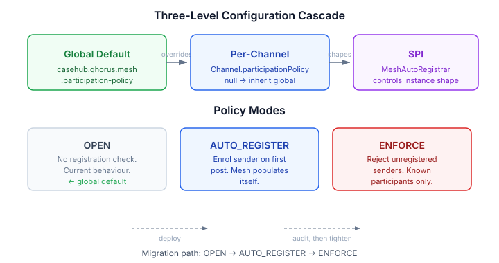
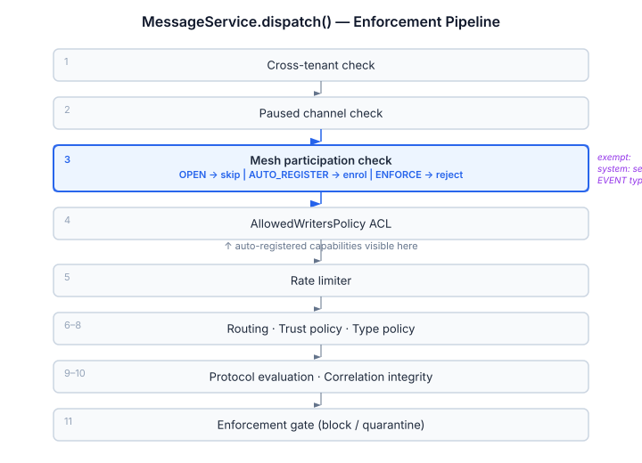

# Who Posted That? Mesh Participation Enforcement

Qhorus channels have always been open by default. Any sender string — registered mesh instance or not — could post a message. The channel stored it, the ledger recorded it, the backends delivered it. The mesh layer was pure opt-in metadata: register if you want presence and discovery, skip it if you don't care.

This works for development. It falls apart in production.

The problem surfaces when you have a Chat tab and a Mesh tab looking at the same data. Three channels with sixteen messages, all posted via direct REST. The Mesh tab shows "no active channels" because none of those senders ever registered as instances. Both tabs query the same Qhorus data — but the mesh layer was bypassed entirely, so one view sees everything and the other sees nothing.

## The fix: a configurable participation policy

Rather than picking one enforcement model and forcing it everywhere, the policy is configurable at three levels: global default, per-channel override, and an SPI for controlling the shape of auto-registered instances.



Three modes:

**OPEN** — current behaviour. No registration check. The global default, so existing deployments don't break.

**AUTO_REGISTER** — if the sender isn't a registered mesh instance, register them before the message is dispatched. The mesh layer fills in automatically. Existing callers keep working; the Mesh tab starts showing what the Chat tab already showed.

**ENFORCE** — if the sender isn't registered, reject the message. For production channels where you need to know every participant before they can post.

## Where the check lives

The participation gate sits inside `MessageService.dispatch()` — after the tenant and paused-channel checks, before the AllowedWritersPolicy ACL.



This position matters: auto-registration happens before the ACL evaluates, so an auto-registered instance with SPI-provided capabilities is immediately visible to capability-based ACL entries.

Two exemptions keep the system sane. System senders — anything with a `:` in the sender string, like `casehub-engine:orchestrator` or `system:watchdog` — bypass the check entirely. They represent infrastructure, not mesh participants. EVENT messages also bypass, same as they do for rate limiting and ACLs.

## Practical: migrating a channel from open to enforced

```properties
# Step 1: deploy with the default — nothing changes
casehub.qhorus.mesh.participation-policy=OPEN

# Step 2: flip specific channels to auto-register
casehub.qhorus.channels.work-channel.participation-policy=AUTO_REGISTER
```

Once AUTO_REGISTER has been running, every sender that posts to the channel is now a registered instance. The mesh layer populates itself. Audit the instance registry, then optionally tighten:

```properties
# Step 3: lock it down
casehub.qhorus.channels.work-channel.participation-policy=ENFORCE
```

The REST and MCP tool surfaces allow the same transition at runtime — `PUT /api/channels/{id}/participation-policy` or the `setParticipationPolicy` MCP mutation.

## The SPI: custom auto-registration

The `MeshAutoRegistrar` interface controls what kind of instance gets created when AUTO_REGISTER fires. The `@DefaultBean` creates a minimal instance — sender ID, status online, no capabilities. Consumers who need richer registration provide an `@Alternative`:

```java
public interface MeshAutoRegistrar {
    Optional<InstanceRegistration> autoRegister(MessageDispatch dispatch);
}
```

Claudony, for example, would override this to attach session bindings, pool-derived capabilities, and case metadata. The SPI receives the full `MessageDispatch` — sender, channel, message type, actor type — so it has everything it needs to make an informed registration decision.

If the SPI returns `Optional.empty()`, registration is skipped and the dispatch proceeds as if the mode were OPEN. If it throws, the dispatch fails — the sender is not registered and the message is not delivered. This is the right default: if you can't determine how to register a sender, rejecting the message is safer than silently allowing it.

## What this doesn't do

Instance registration is global — once a sender is auto-registered by one channel, they pass the ENFORCE check on every channel. The participation policy ensures mesh visibility, not per-channel access control. Channel-level gating is still the job of `allowedWriters` — the ACL that was always there.

The distinction matters for operators: ENFORCE means "you must be a known entity to post here." It does not mean "only authorised agents can post here." Those are different policies at different layers, and conflating them would create confusion when a sender registered via one channel's AUTO_REGISTER silently passes another channel's ENFORCE.
